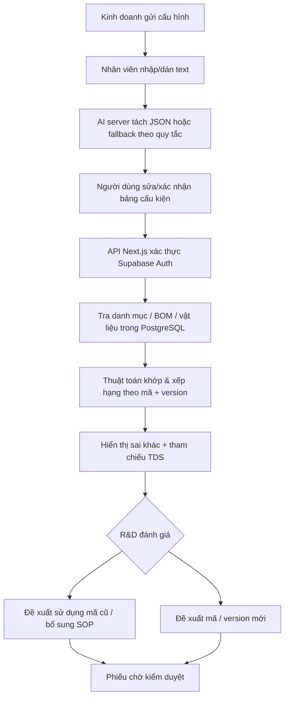

# ĐẶC TẢ CHỨC NĂNG — R&D AI ASSISTANT

**Trạng thái:** Đặc tả MVP + hướng mở rộng. Nguồn: `QUY TRÌNH R&D.docx`, `STOCK_ITEMS (OFFICIAL).xlsx`, `LIST_OF_ITEM_ATTRIBUTES (OFFICIAL).xlsx`, `LIST_OF_BOM_VIEW (OFFICIAL).xlsx`, và 10 PDF TDS tham chiếu.

## 1. Mục tiêu

Nhận cấu hình kỹ thuật do phòng kinh doanh gửi, xác định các bán thành phẩm (BTP) và nguyên vật liệu (NVL), tìm các mã thành phẩm/phiên bản đã tồn tại, so sánh về cấu hình/thiết kế, và đưa ra kết luận **có thể xem xét dùng mã cũ / cần bổ sung hồ sơ / đề xuất mã hoặc version mới**. Mỗi kết luận có bảng chứng cứ, không được tự suy đoán từ trí nhớ AI.

## 2. Vai trò

- **Kinh doanh:** cung cấp cấu hình yêu cầu.
- **Nhân viên R&D:** nhập, sửa dữ liệu được AI tách, đánh giá bảng sai khác, lập đề xuất.
- **Người phê duyệt R&D (giai đoạn sau):** kiểm tra và phê duyệt mã mới/version mới/BOM/TDS/SOP.
- **Admin dữ liệu:** nhập Excel/PDF đã xác minh và quản trị quyền.

## 3. Quy trình nghiệp vụ gốc

### Bước 1. Nhận yêu cầu
Nhận nguyên văn nội dung cấu hình kỹ thuật; lưu vết phiên phân tích, người tạo và thời điểm.

### Bước 2. Phân tích
Chuyển văn bản thành danh sách có STT, tên thành phần, số lượng, rộng/dài (cm), chất liệu/yêu cầu khác. AI chỉ hỗ trợ **tách dữ liệu**. Thiếu kích thước/số lượng/chất liệu thì yêu cầu xác nhận, không tự bịa. Có thể nhập/sửa bằng bảng thủ công.

### Bước 3. Kiểm tra mã hiện có

- **3.1** Ưu tiên cấu kiện đặc trưng/ít phổ biến để lọc danh sách mã thành phẩm từ BOM; kiểm tra theo sản phẩm + **version**.
- **3.2** Đối chiếu tiếp toàn bộ thành phần cấp 1, số lượng, kích thước, và vật liệu cấp 2 trên BOM. Đối chiếu TDS tương ứng và SOP của BTP nếu có.
- **3.3** Nếu mã gần giống, hiển thị sai khác để con người xác minh. Chỉ báo đã hoàn thành khi **BOM + TDS + SOP phù hợp, đầy đủ và được phê duyệt**.
- **3.4** Nếu các mã nghi vấn đều thiếu thành phần, thiếu số lượng, hoặc khác kích thước đáng kể: chuyển đề xuất mã mới/version mới. Phải kiểm tra hết các ứng viên phù hợp trước khi kết luận.

### Bước 4. Đề xuất mã hoặc version mới
MVP tạo **phiếu đề xuất chờ duyệt**, tham chiếu mã cũ + version. Không tự cấp mã chính thức hoặc cập nhật ERP.

### Bước 5. Lắp cấu trúc mới

- **5.1** Tìm mã BTP/NVL tương đương đã tồn tại, làm cơ sở xây dựng BOM/TDS/SOP mới (phase sau).
- **5.2** Nếu cấu kiện chưa tồn tại, ghi nhận nhu cầu tạo mã BTP/NVL mới và chuẩn hóa BOM/SOP của BTP đó trước khi tổng hợp thành phẩm (phase sau).

## 4. Dữ liệu nguồn và xử lý

| Nguồn | Ý nghĩa | Điều cần tránh |
|---|---|---|
| STOCK_ITEMS | Mã, phiên bản, phân loại (TP/BTP/NVL), mô tả | Không bỏ version của thành phẩm. |
| LIST_OF_ITEM_ATTRIBUTES | Rộng, dài, cao, mô tả | Xác nhận đơn vị và quy tắc đảo chiều; tránh tự chuyển mm↔cm. |
| LIST_OF_BOM_VIEW, sheet chính thức | TP version → BTP/NVL cấp 1 (I, M) → NVL cấp 2 (O, Q) | Nhiều dòng có cùng BTP chỉ vì một BTP dùng nhiều NVL: **không cộng số lượng BTP mỗi dòng**. |
| TDS PDF tham khảo | Cấu hình đã ban hành theo mã/version | Không coi nội dung TDS là đã kiểm chứng tự động. |
| SOP | Quy trình công đoạn/chế tạo | **Chưa có trong các tài liệu được cung cấp**. |

Cột BOM quan trọng: `C=product_code`, `E=version`, `I=component_code`, `J=component_name`, `K=Show (Hiện trên TDS)`, `M=BomQtyLevel1`, `N=RoutingName2`, `O=material_code`, `P=material_name`, `Q=BomQtyLevel2`. Dùng sheet `Qry_LIST_OF_BOM_VIEW` làm chuẩn; bỏ qua sheet BOM nháp.

## 5. Khớp cấu hình, sai khác và giới hạn

- **Khớp mã chính xác** được ưu tiên khi người dùng biết mã.
- **Khớp tên**: chuẩn hóa dấu, chữ hoa/thường; so sánh từ khóa nhưng không tự xem mọi từ gần nhau là tương đương kỹ thuật.
- **Kích thước**: đối chiếu đúng **rộng × dài**, quy tắc ±5% cho từng trục chỉ là mặc định thử nghiệm. Nếu đảo chiều phải cảnh báo.
- **Số lượng**: so sánh nguyên tắc `số lượng yêu cầu = số lượng cấu kiện cấp 1`, không dùng BOM tổng nguyên liệu cấp 2 để đại diện.
- **Vật liệu**: khi có yêu cầu vật liệu, dùng tên NVL cấp 2 làm dấu hiệu sơ bộ; cần SOP/TDS xác nhận đặc tính (định lượng gsm, lớp vải, keo, chống thấm...).
- **Hệ số điểm**: chỉ phục vụ xếp hạng ứng viên. Mỗi sai khác/thiếu thông tin hiển thị minh bạch; ngưỡng không thay thế quyết định kỹ thuật.
- **Sản phẩm thêm**: số lượng BTP/NVL tồn tại trong sản phẩm nhưng không nằm trong yêu cầu cần được báo cáo.
- **Kết luận cuối cùng** do R&D duyệt. Nếu thiếu TDS/SOP thì tuyệt đối không gán nhãn hoàn thành.

## 6. Trường hợp kiểm thử từ tài liệu

Ví dụ yêu cầu 15 dòng (BTP từ STT 1–13; NVL STT 14–15), sử dụng **Khăn phủ dụng cụ có keo 100 × 200 cm (STT 9)** để tìm mã BTP `SP.01.22-02` và `SP.01.22-03`.

Dùng BOM suy ra các thành phẩm chứa BTP trên và kiểm tra các TDS tương ứng. Tài liệu xác định ứng viên phù hợp nhất là **`TM.08.04-15`, version `2`**, có hai điểm cần R&D xác nhận:

1. **STT 11**: Túi kim chỉ yêu cầu **15 × 15 cm**, nhưng TDS tương ứng ghi **18 × 20 cm**.
2. **STT 13**: yêu cầu tên **Khăn đa dụng**, TDS dùng tên **Khăn không keo**.

**Acceptance test:** hệ thống phải tìm được mã + phiên bản có liên quan, hiển thị cụ thể 2 sai khác trên, không tự đổi 18×20 thành 15×15, không tự coi hai tên là đồng nghĩa chính thức; không tự ghi “hoàn thành task” khi thiếu SOP hoặc chưa duyệt sai khác.

Một tình huống kiểm thử BOM khác: `TM.08.04-15::2` có mã BTP `SP.01.01-04` xuất hiện trong nhiều dòng con theo NVL. TDS ghi **2 cái**. Bộ importer phải không đếm nhầm **số dòng NVL thành số lượng BTP**, và cần QA cơ chế nhận diện hai lần xuất hiện thực sự.

## 7. Quy trình kỹ thuật/API

| Endpoint | Method | Chức năng | Quyền |
|---|---|---|---|
| `/api/parse` | POST | Text → cấu kiện | Người dùng đăng nhập |
| `/api/analyze` | POST | Đối chiếu BOM/danh mục và lưu lịch sử | Người dùng đăng nhập |
| `/api/proposals` | POST | Lập phiếu đề xuất | Người dùng đăng nhập |
| `/api/documents?productKey=...` | GET | Mở TDS qua URL Storage ký ngắn hạn | Người dùng đăng nhập |

## 8. Việc chưa có trong MVP / backlog

- Parser bảng PDF/TDS chính xác (bao gồm nhiều trang, gộp ô, nhận diện bảng, đối chiếu version từ nội dung PDF).
- Import và kiểm chứng SOP; sinh BOM/SOP/TDS chuẩn theo form ban hành.
- Mô hình một BTP có nhiều cấu hình và vật liệu khác nhau theo version.
- Quy tắc đồng nghĩa có xác nhận (ví dụ “Khăn đa dụng” ↔ “Khăn không keo”).
- Kiểm thử số lượng ở BOM 2 cấp với đủ các mã phức tạp và ưu tiên lọc theo độ hiếm thống kê của BTP.
- Vai trò reviewer/approver, lịch sử phê duyệt, chữ ký điện tử và phiên bản tài liệu.
- Luồng cấp mã và đồng bộ ERP theo quy tắc đặt mã doanh nghiệp.
- Chống chạy import đồng thời, rollback nhiều bảng, giám sát chất lượng dữ liệu và xử lý bản ghi nguồn bị xóa.
- Quota/rate limit AI, audit truy cập dữ liệu, giới hạn cước AI, đính kèm mọi nguồn chứng cứ.

## 9. Điều kiện để triển khai sản xuất

1. Chạy thử trên bản sao dữ liệu, so sánh nhiều bộ TDS thực tế và hiệu chỉnh heuristic nhóm BOM.
2. Kiểm chứng mọi cách tính số lượng và đơn vị kích thước theo chuẩn công ty.
3. Bổ sung SOP, chốt quy tắc “gần giống tương đối” thành ngưỡng riêng theo nhóm sản phẩm.
4. Thiết lập người duyệt và vòng đời tài liệu.
5. Bảo vệ `service role key`, xác nhận RLS, kiểm tra lộ dữ liệu trên repo/Vercel và phân quyền Storage.
